  

I'm a CS&E diploma student at SLIET, India. I like working one layer below the framework: data structures, wire protocols and sockets, and finding out what a program does with the bytes it receives. Most of what's below is built without a framework on purpose, to learn how the pieces work.

Right now I'm building **MiniCache**, an in-memory key-value store in Java that speaks the Redis RESP protocol.

 

## A session against MiniCache

  

The `>>` and `<<` lines are the raw bytes of each request and reply, which is what the server actually parses and writes.

 

## Projects

| Project | What it does | Built with |
| :-- | :-- | :-- |
| [**MiniCache**](https://github.com/logicbyabhinav/MiniCache) | In-memory cache daemon that speaks RESP over raw TCP sockets. Separate-chaining hash table with polynomial hashing, O(1) LRU eviction on a doubly linked list with sentinel nodes, absolute-deadline TTLs with lazy expiry on read, and a synchronized core served by a worker pool. | Java 21 |
| [**VoltDrive**](https://github.com/logicbyabhinav/VoltDrive) | Self-hosted file manager that runs straight from a USB drive or external disk with no installation. Browse, stream and upload from any device on the network, with live updates across devices over Server-Sent Events. | Node.js, Express |
| [**OmniDrive**](https://github.com/logicbyabhinav/OmniDrive) | Combines the free quotas of several Google Drive accounts into one virtual drive. Files are split and encrypted in the browser with AES-256-GCM before upload, so there is no backend holding user data. | JavaScript, PWA, Web Crypto API |
| [**SLIET Market**](https://github.com/logicbyabhinav/SLIETmarket) | Campus marketplace for student-to-student trading, with offers, negotiation and relisting after disputes. Multi-document updates use Firestore batch writes so a trade never half-completes. | JavaScript, Firebase |

### How MiniCache evicts

  

 

## Activity

Generated by a GitHub Action every six hours from my public GitHub data.

  

  

 

 

## Languages and Tools

  

 

## Connect with me

  
  &nbsp;
  

