  

I'm a CS&E diploma student at SLIET, India. I focus on backend systems: data structures, wire protocols, and sockets, working directly with raw bytes and memory without heavy framework abstractions.

 

### Currently

- **Building**: [MiniCache](https://github.com/logicbyabhinav/MiniCache), a standalone in-memory key-value store in Java 21 speaking the Redis RESP protocol.
- **Learning**: Wire protocol byte deserialization, race-condition mitigation in multi-threaded socket servers, and sentinel doubly-linked list mechanics.
- **Next up**: Pipelined command execution and benchmarking against standard Redis clients with `redis-benchmark`.

 

## Projects

<table width="100%">
<tr>
<td valign="top" width="50%">

### [MiniCache](https://github.com/logicbyabhinav/MiniCache)
`Status: Active Development` · `In-Memory Key-Value Store`

> A standalone caching daemon built in Java 21 that speaks the Redis RESP wire protocol over raw TCP sockets with zero third-party dependencies.

- **Storage**: Custom separate-chaining hash table with polynomial rolling hash
- **Eviction**: $O(1)$ LRU queue using a Doubly Linked List with Sentinels
- **Expiry**: Absolute 64-bit epoch TTL with lazy pruning on read
- **Protocol**: Wire-compatible with Redis clients (`PING`, `SET`, `GET`, `DEL`, `EXISTS`)
- **What I learned**: Cache-aside semantics, thread synchronization without high-level collections, and byte-level socket deserialization.

`Java 21` · `TCP Sockets` · `RESP Protocol` · `Data Structures`

</td>
<td valign="top" width="50%">

### [VoltDrive](https://github.com/logicbyabhinav/VoltDrive)
`Status: Stable` · `Zero-Install Portable File Server`

> A self-hosted file management daemon designed to run directly from USB drives or external disks without local installation.

- **Filesystem**: Local directory navigation, streaming file previews, and chunked uploads
- **Sync**: Real-time multi-device synchronization via Server-Sent Events (SSE)
- **Zero-Footprint**: Launches portably on the host and serves across the local network
- **What I learned**: Managing Node.js stream backpressure, buffer piping, and persistent HTTP connections.

`Node.js` · `Express` · `Server-Sent Events` · `Filesystem I/O`

</td>
</tr>
<tr>
<td valign="top" width="50%">

### [OmniDrive](https://github.com/logicbyabhinav/OmniDrive)
`Status: Stable` · `Client-Side Encrypted Storage Aggregator`

> Combines the free storage quotas of multiple Google Drive accounts into one virtual unified drive.

- **Crypto**: Client-side AES-256-GCM chunking in the browser before upload
- **Assembly**: Multi-part streaming assembly across independent OAuth accounts
- **Privacy**: No intermediate server holds files; encryption keys remain on the client
- **What I learned**: Asynchronous Web Crypto API primitives, browser `ArrayBuffer` memory boundaries, and multi-part upload coordination.

`JavaScript` · `PWA` · `Web Crypto API` · `Google Drive API`

</td>
<td valign="top" width="50%">

### [SLIET Market](https://github.com/logicbyabhinav/SLIETmarket)
`Status: Stable` · `Campus Peer-to-Peer Marketplace`

> Campus marketplace for student bidding, item negotiations, and inventory exchange.

- **Transactions**: Atomic offer acceptance via Firestore Batch Writes to prevent partial commits
- **State Machine**: Real-time offer bidding with automated relisting on disputes
- **Optimization**: Base64 payload optimization to stay within serverless document limits
- **What I learned**: NoSQL schema boundaries, distributed transaction limits, and real-time document synchronization.

`JavaScript` · `Firebase Firestore` · `Serverless` · `NoSQL`

</td>
</tr>
</table>

 

## Activity

Generated by a GitHub Action every six hours from public GitHub contributions.

  

 

## Languages and Tools

<table>
  <tr>
    <td align="center" width="80"> <b>Java 21</b></td>
    <td align="center" width="80"> <b>C</b></td>
    <td align="center" width="80"> <b>C++</b></td>
    <td align="center" width="80"> <b>Python</b></td>
    <td align="center" width="80"> <b>JavaScript</b></td>
    <td align="center" width="80"> <b>Node.js</b></td>
    <td align="center" width="80"> <b>Express</b></td>
    <td align="center" width="80"> <b>Firebase</b></td>
    <td align="center" width="80"> <b>Linux</b></td>
    <td align="center" width="80"> <b>Bash</b></td>
    <td align="center" width="80"> <b>Git</b></td>
    <td align="center" width="80"> <b>VS Code</b></td>
  </tr>
</table>

 

## Connect with me

  
  &nbsp;&nbsp;&nbsp;
  

